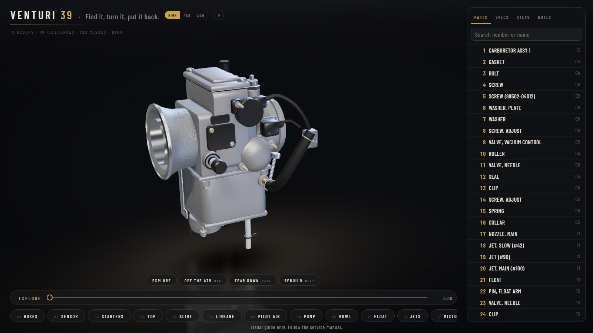

# VENTURI 39

**Live:** https://simsi2027.github.io/venturi/

An interactive three.js guide to a Keihin flat-slide carburetor with accelerator pump (the one on a 2004
YFZ450, I.D. mark 5TG1 00), built entirely in code. Every one of the 79 parts-diagram references is a clickable part:
find it, see where it sits, and follow the order it comes off and goes back.

## Controls

- **Drag** to orbit, **wheel / pinch** to zoom. The page opens on the assembled carburetor; idle, the view sways gently.
- **EXPLODE** slider: the 13 groups come apart in the service manual's order, then each group's parts.
- **Group pills (01-13)**: fly to a group; the rest dim.
- **Hover** a part for its name; **click** it to bring it forward (the rest fades to 10%), **drag** to turn it a full 360 degrees on both axes and use the **wheel** to zoom it. Esc or click away puts it back.
- **Parts** panel: search all 79 references by number or name; **Specs** lists the specifications; **Steps** lists the
  current guided mode; **Notes** keeps your own numbers (pilot screw turns, jets found) in this browser.
- **Off the ATV / Tear down / Rebuild**: guided steps with **Back / Next / Done** (or the arrow keys), the camera on the
  current part, a one-line note, brass callouts on the rebuild and a checkbox per step, saved in this browser. Off the ATV
  (9 steps) outlines in brass the carburetor part each step names; tear down and rebuild have 27 steps each.
- **?** (button or key) shows these controls on the page.
- **High / Med / Low** sets the render quality; `?perf=1` shows a performance overlay.

## Notice

**Visual guide only. Follow the service manual.** Shapes are eyeballed from the parts diagram and the manual's
drawings: no real dimensions, no CAD. Specifications shown come from the service manual only.

## Credits

- [three.js](https://threejs.org) (MIT)
- Build step and studio setup from the [cutaway](https://github.com/Nyxera0x/cutaway) skill by Nyxera0x
- Font: Barlow Condensed (SIL OFL)

MIT licensed, see [LICENSE](LICENSE).
